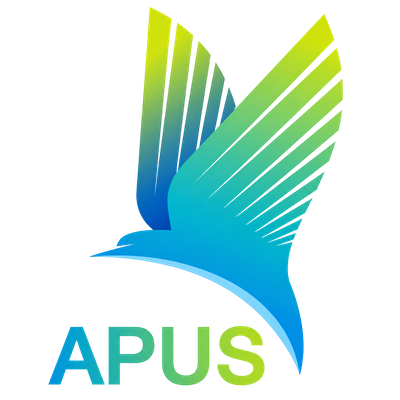
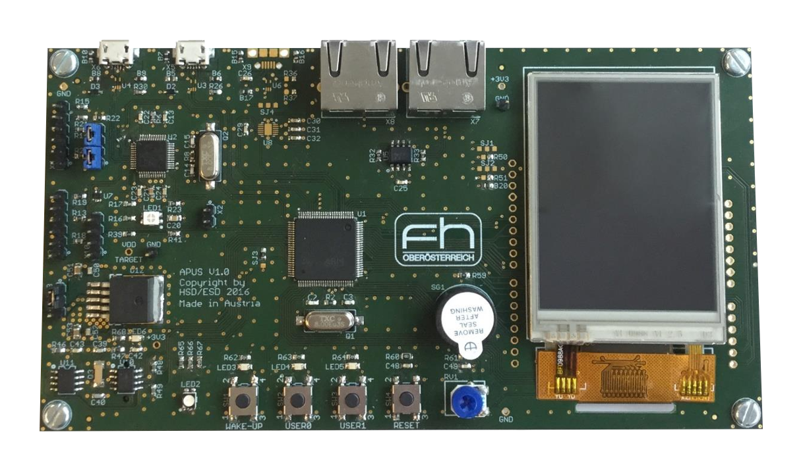

  

Open-source organization for the APUS board, the development board of the [Hardware-Software-Design (HSD)](https://fh-ooe.at/en/degree-programs/hardware-software-design-bachelor) and [Embedded Systems Design (ESD)](https://fh-ooe.at/en/degree-programs/embedded-systems-design-master) degree programs at the University of Applied Sciences Upper Austria.

  

